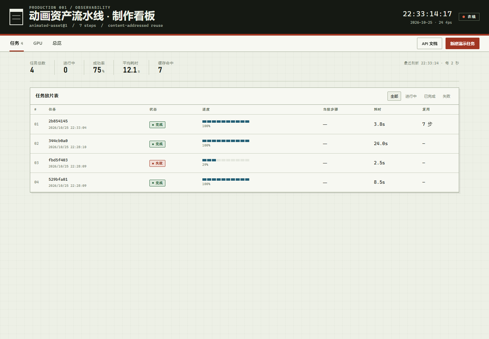
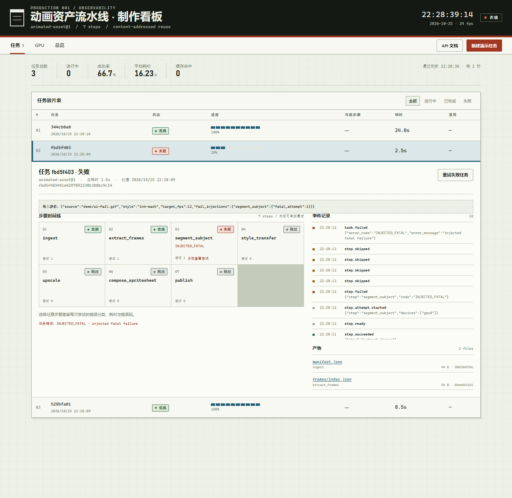
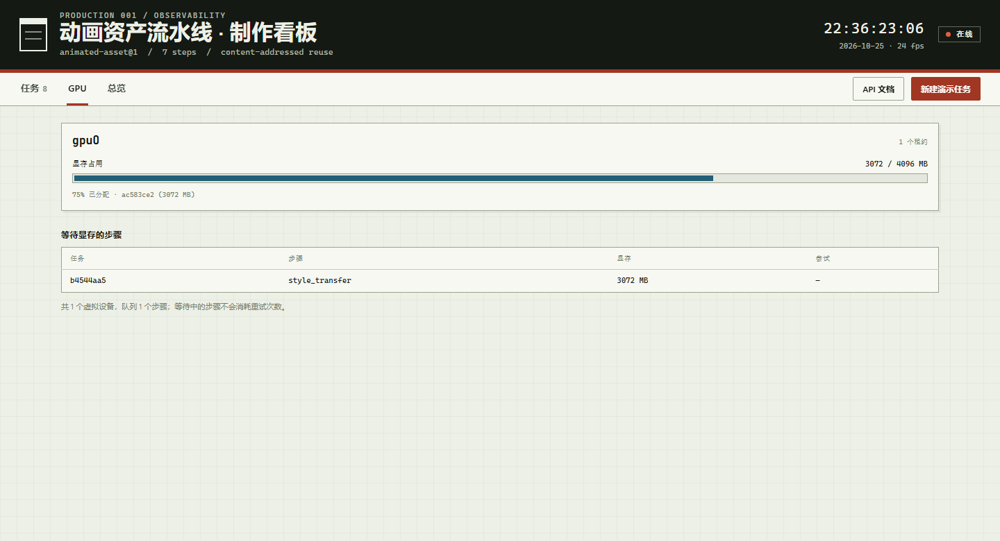
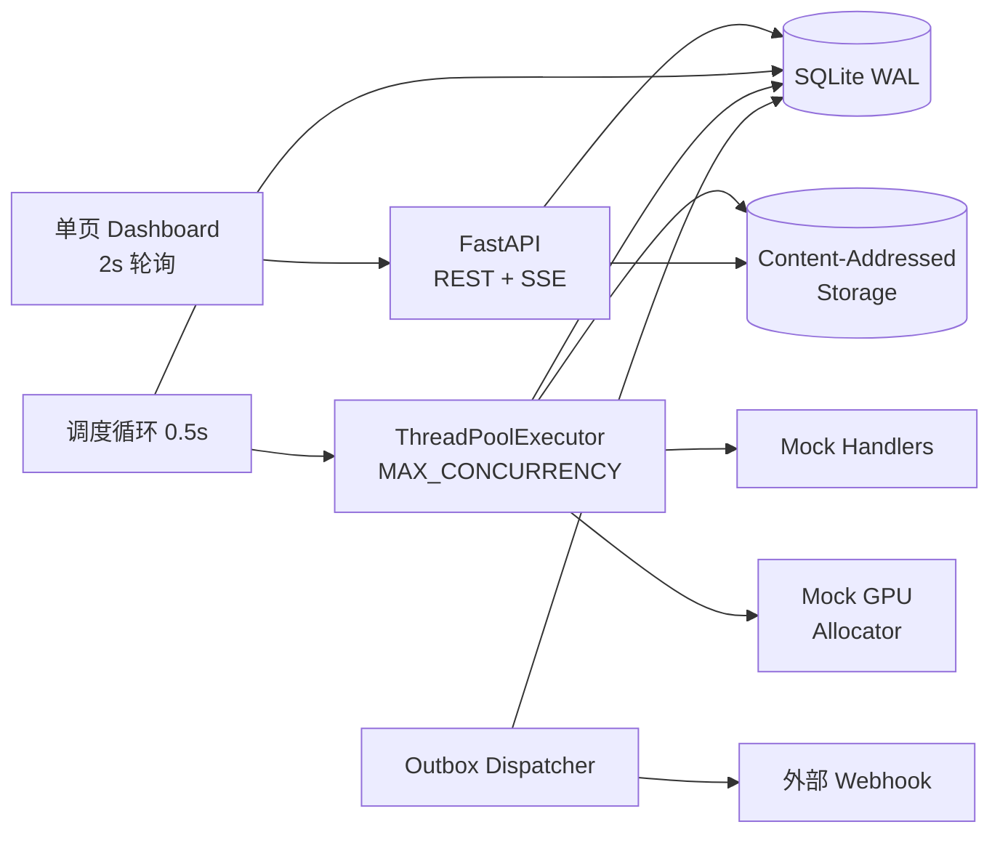

# Observable AI Pipeline · 可观测 AI 任务执行流水线

一个单进程、可本地一键运行的 AI 长任务执行 MVP：任务按 DAG 拆成步骤，支持步骤级重试、断点恢复、结果复用、事件审计、Mock GPU 调度与实时 Dashboard。演示管道把一张动图处理成动画资产（7 步，Mock 实现，毫秒级到秒级可观察）。



## 1. 快速开始

要求 Python 3.11+（本仓库在 3.12.4 验证）。

```bash
python -m venv .venv
# Windows
.venv\Scripts\activate
# macOS / Linux
# source .venv/bin/activate

pip install -r requirements.txt
python -m uvicorn app.main:app --host 127.0.0.1 --port 8000
```

打开 <http://127.0.0.1:8000>。API 文档在 `/docs`，指标在 `/metrics`，健康检查在 `/healthz`。

也可以用 Make（需要本机有 `make`）：

```bash
make install
make run          # --reload，端口 8000
make test         # 7 个单元 / API 测试
make demo         # 7 个端到端演示场景
make reset        # 删除 data/ 与 logs/
```

Docker：

```bash
docker compose up --build
# 打开 http://127.0.0.1:8000
```

> 数据默认落在 `data/`（SQLite + 内容寻址产物），日志在 `logs/`。两者都已加入 `.gitignore`。复制 `.env.example` 为 `.env` 可调整端口、并发、租约时间和 Mock GPU 配置。

## 2. 演示

演示脚本会在 `8020` 端口启动一个临时服务，使用临时数据目录，不污染本地 `data/`：

```bash
python scripts/demo.py all
# 或单个场景
python scripts/demo.py cache
```

预期输出：

```text
[PASS] normal PASS (9 artifacts)
[PASS] retry PASS (transient failure, 2 attempts)
[PASS] fatal PASS (fatal failure, downstream skipped)
[PASS] cache PASS (7/7 steps reused across tasks)
[PASS] gpu PASS (queue observed, CUDA_OOM retried, both tasks succeeded)
[PASS] cancel PASS (running step canceled, upstream artifacts preserved)
[PASS] crash PASS (hard kill, RUNNING step resumed, task succeeded)
```

| 场景 | 做了什么 | 可观察结果 |
|---|---|---|
| normal | 提交一次完整任务 | 7 步全部成功，产出 9 个 CAS 文件 |
| retry | 在 `extract_frames` 注入一次可重试失败 | 第 1 次 FAILED，退避后第 2 次 SUCCEEDED |
| fatal | 在 `segment_subject` 注入致命错误 | 任务 FAILED，下游步骤 SKIPPED，错误码保留 |
| cache | 用相同输入提交两次 | 第二次 7/7 步命中 `step_cache`，不执行 handler、不占 GPU |
| gpu | 单个 4 GB 卡上两个并发任务争抢显存 | 出现 `WAITING_RESOURCE` 队列；OOM 自动重试后两个任务都成功 |
| cancel | 在 `style_transfer` 运行时取消 | 当前步骤取消，未开始步骤取消，上游产物保留 |
| crash | 在 `style_transfer` 运行时 `kill` 进程再启动 | 启动对账将孤儿尝试标为 ABANDONED，步骤重新执行并最终成功，事件含 `recovery.resumed` |

故障通过任务参数 `fail_injections` 注入，只在 Mock handler 中使用：

```json
{
  "pipeline": "animated-asset",
  "version": "1",
  "params": {
    "source": "demo/in.gif",
    "style": "watercolor",
    "target_fps": 12,
    "fail_injections": {
      "extract_frames": {"retryable_times": 1},
      "segment_subject": {"fatal_attempt": 1}
    },
    "slow_steps": {"style_transfer": 6}
  }
}
```



GPU 面板在单卡 4 GB 配置下显示租约占用与 `WAITING_RESOURCE` 队列：



## 3. 架构



单进程包含四个后台组件：调度器、心跳/超时巡检、Outbox 派发器、SQLite 写事务。所有状态变更、事件和回调入队都走同一个数据库事务；API 与执行器通过 SQLite 交换状态，不共享可变内存。

**为什么是单进程 + SQLite**：MVP 的目标是让恢复、复用、可观测这些语义可被完整演示和解释。SQLite 的 `BEGIN IMMEDIATE` + 进程内单写锁可以把事务边界做得很清楚；无需引入 Redis/Postgres/Celery 就能保证「状态变化」与「事件追加」原子提交。代价是写吞吐受限，演进路径见 §9。

## 4. 状态机与失败语义

三级状态：Task → Step → Attempt。

```text
Task    PENDING → RUNNING → SUCCEEDED | FAILED | CANCELED
                          └ FAILED → RUNNING（人工重试）

Step    PENDING → READY → RUNNING → SUCCEEDED
                    ↑        ├→ RETRYING → READY（自动重试）
                    │        ├→ FAILED
                    │        └→ CANCELED
                    └── WAITING_RESOURCE（GPU 不足）

Attempt RUNNING → SUCCEEDED | FAILED | CANCELED | ABANDONED
```

| 错误分类 | 触发 | 处理 |
|---|---|---|
| `RETRYABLE` | 瞬时故障、OOM、超时 | 按指数退避自动重试，直到 `retry_max` |
| `FATAL` | 输入非法、不可恢复错误 | 步骤 FAILED，下游 SKIPPED，任务 FAILED |
| `CRASH` | 进程退出、租约/对账发现孤儿 | Attempt ABANDONED；**不消耗重试预算**；步骤回到 READY |

`retry_max` 是包含首次执行的总尝试次数（例如 2 表示首次 + 1 次重试）。人工重试会把该步骤的计数器清零，并重置所有下游步骤及其产物引用，但保留 `step_cache`，因此「重跑」仍可能复用未变化的上游结果。

## 5. 步骤与依赖

定义在 [`pipelines/animated-asset.v1.json`](pipelines/animated-asset.v1.json)，线性 DAG：

```text
ingest → extract_frames → segment_subject → style_transfer → upscale
       → compose_spritesheet → publish
```

| # | 步骤 | GPU | 超时 | 最大尝试 | 产物 |
|---|---|---|---|---|---|
| 1 | ingest | - | 30s | 2 | manifest.json |
| 2 | extract_frames | - | 120s | 3 | frames/index.json |
| 3 | segment_subject | 1 × 2048 MB | 180s | 3 | masks/index.json |
| 4 | style_transfer | 1 × 3072 MB | 240s | 2 | styled/index.json |
| 5 | upscale | 1 × 2560 MB | 180s | 3 | upscaled/index.json |
| 6 | compose_spritesheet | - | 120s | 2 | spritesheet.png, preview.gif |
| 7 | publish | - | 60s | 3 | bundle.json, checksums.txt |

步骤通过 YAML/JSON 风格声明式定义；`params: {"source": "$task.source"}` 把任务参数绑定进步骤有效配置，并参与指纹计算。Handler 注册在 `app/handlers.py`，Mock 输出带有输入 `source`，以保证不同输入产生不同内容（见 §13 的缓存误命中案例）。

## 6. 持久化设计

| 表 | 作用 | 关键字段 |
|---|---|---|
| `tasks` | 任务级状态、参数、回调 | `status`, `trace_id`, `cancel_requested`, `error_code` |
| `steps` | 步骤定义快照与状态 | `depends_on_json`, `config_json`, `fingerprint`, `retry_count`, `timeout_s` |
| `step_attempts` | 每次执行的审计记录 | `attempt_no`, `status`, `lease_expires_at`, `metrics_json`, `log_path` |
| `artifacts` | 任务产物引用 | `sha256`, `size_bytes`, `mime` |
| `step_cache` | 跨任务结果复用 | `fingerprint` → artifacts + `hit_count` |
| `events` | 追加式事件流 | `type`, `payload_json`, `trace_id`, `span_id` |
| `gpu_leases` | Mock GPU 租约 | `device_id`, `attempt_id`, `memory_mb`, `expires_at` |
| `outbox` | 终态回调发件箱 | `idempotency_key`, `status`, `attempts`, `next_attempt_at` |

选择理由：

- **SQLite WAL**：零外部依赖，读不阻塞写；所有写操作经 `app.db.tx()` 串行化，避免并发状态竞争。
- **事件与状态同事务**：不会出现「状态已变但事件缺失」或「事件已写入但状态未提交」。
- **CAS 原子写**：临时文件 → `fsync` → `os.replace`，按 SHA-256 分两段目录存放；重复写入天然幂等。
- **Outbox 同事务入队**：任务进入终态时写 `outbox`，由后台线程按至少一次语义投递；接收方用 `Idempotency-Key`（`task:<status>`）去重。
- **Attempt 独立成表**：重试不是覆盖旧记录，能回答「第几次、为什么失败、耗时多少」。

## 7. 恢复与复用机制

### 7.1 崩溃恢复

1. Attempt 在派发事务中写入 `lease_expires_at`；执行线程每 5 秒续租。
2. 启动时 `_reconcile()` 把数据库中所有仍为 `RUNNING` 的 Attempt 标为 `ABANDONED`（原因 `PROCESS_RESTART`）。
3. 对应 Step 回到 `READY`，GPU 租约全部释放，`tmp/` 清理。
4. 调度器重新派发该 Step；新 Attempt 的 `attempt_no` 递增，但 `retry_count` 不变。
5. 如果进程恰好死在「产物已写 CAS、数据库尚未提交」之间，CAS 中可能有孤儿文件，但不会产生错误状态；重新执行会写入相同内容。

单实例假设：启动对账把所有 RUNNING 尝试视为孤儿。多实例部署必须改为「仅回收租约已过期的尝试」，见设计规格 §9.4。

### 7.2 结果复用

步骤指纹：

```text
sha256(canonical_json(
  pipeline@version + step_name + effective_config
  + sorted(dependency_artifact_sha256) + handler_version
))
```

命中 `step_cache` 且 CAS 文件存在、大小匹配时，直接登记 artifacts、写 `step.cache_hit` / `step.succeeded` 事件，不执行 handler、不申请 GPU。缓存命中仍走 `READY → RUNNING → SUCCEEDED` 的合法状态迁移，因此 Dashboard 与事件流的语义一致。

`fail_injections` 是演示参数，不参与指纹：真实故障不应让缓存结果失效。演示场景因此为每个任务生成唯一 `source`，避免上一场景的缓存掩盖故障注入。

## 8. API 摘要

| 方法 | 路径 | 说明 |
|---|---|---|
| POST | `/api/tasks` | 创建任务，校验 pipeline、参数、GPU 容量、回调 URL |
| GET | `/api/tasks` | 列表（`status`, `limit`, `cursor`） |
| GET | `/api/tasks/{id}` | 详情：步骤、事件、产物、进度 |
| GET | `/api/tasks/{id}/steps` | 步骤列表 |
| GET | `/api/tasks/{id}/steps/{name}/attempts` | 尝试记录 |
| GET | `/api/tasks/{id}/events` | 增量事件（`after`） |
| GET | `/api/tasks/{id}/stream` | SSE 事件流（`Last-Event-ID`） |
| POST | `/api/tasks/{id}/cancel` | 请求取消 |
| POST | `/api/tasks/{id}/retry` | 重试失败任务 |
| POST | `/api/tasks/{id}/steps/{name}/retry` | 重试单步及下游 |
| GET | `/api/tasks/{id}/artifacts` | 产物列表 |
| GET | `/api/artifacts/{id}/download` | 下载产物 |
| GET | `/api/gpu` | Mock GPU 设备、租约、队列 |
| GET | `/api/overview` | 任务计数、成功率、平均耗时、缓存命中 |

Dashboard 使用 2 秒轮询（SSE 端点保留给上游集成）；所有动态文本都经过转义后写入 DOM。

## 9. 从秒级到小时级的演进

当前实现把「状态持久化 + 步骤边界」做对了，但一步仍是同步函数调用。小时级任务需要：

1. **Worker 化**：SQLite 保留为元数据/事件库，或换 Postgres；调度器通过队列（Redis Streams / SQS）派发，多 worker 按租约抢占。恢复语义从「启动全量对账」改为「租约过期回收」。
2. **步骤内 checkpoint**：大步骤拆成可提交的 chunk（帧段、分片），每个 chunk 记 `checkpoint` 与产物；恢复从最后一个已提交 chunk 继续。
3. **对象存储**：CAS 从本地磁盘迁移到 S3/OSS，产物清单存数据库；大文件校验异步化。
4. **心跳与超时服务化**：独立租约服务或数据库定时扫描，避免单进程心跳线程成为单点。
5. **可观测性**：OpenTelemetry trace（`trace_id` / `span_id` 已落库）、结构化日志集中采集、Prometheus 告警（队列长度、租约过期、回调积压）。
6. **产物生命周期**：TTL、引用计数、GC 与冷热分层；当前没有自动清理。
7. **调度公平性**：按用户/项目配额、优先级、抢占；当前是 FIFO + 单进程线程池。

完整取舍与接口演进见 [`docs/superpowers/specs/2026-10-25-observable-ai-pipeline-mvp-design.md`](docs/superpowers/specs/2026-10-25-observable-ai-pipeline-mvp-design.md) §17。

## 10. 实现方式与时间规划

实际按 5 个任务推进，2 个检查点：

| 阶段 | 内容 | 计划 | 实际 |
|---|---|---|---|
| Task 1 | 配置、Schema、状态机、流水线加载、指纹、单测 | 45 min | 完成 |
| Task 2 | CAS、事件、指标、Mock handler、GPU、执行器；**CP1** | 90 min | 完成，CP1 通过 |
| Task 3 | REST API、SSE、Metrics、回调 Outbox、API 冒烟 | 60 min | 完成 |
| Task 4 | 单文件 Dashboard（任务/详情/事件/产物/GPU/总览） | 90 min | 完成，含桌面与移动端检查 |
| Task 5 | 演示脚本、Docker、Makefile、README；**CP2** | 90 min | 完成，7/7 场景通过 |

计划原为 1 个工作日；实际由单次 AI 结对会话完成，整体墙钟约 1.5 小时（含设计、实现、截图与端到端复跑），主要节省来自：先写规格与计划、把验证压缩为 CP1/CP2、以及只保留 7 个单元/API 测试 + 7 个演示场景。

与计划的偏差：

- 没有拆 subagent 并行，按单线程顺序执行，减少上下文切换。
- 规格中的 4 天排期按用户要求压缩到 1 天口径。
- 按用户要求不做覆盖率门槛、额外静态检查阶段；用 CP1/CP2 端到端断言兜底。
- 步骤超时已实现，但没有单独演示场景；`force=true` 强制重跑未实现。
- Dashboard 额外做了移动端适配、深链接（`?task=`、`?tab=`）与无障碍焦点样式。

## 11. AI Coding 工具与 Token 消耗

- 工具：Claude Code（Skills：brainstorming、writing-plans、executing-plans、frontend-design、dataviz）。
- 本会话运行模型记录：`deepseek-v4-flash`（来自本地 cost-state）。
- 会话累计（cost-state 快照，非最终账单）：

| 指标 | 数值 |
|---|---|
| 输入 token | 37,384 |
| 输出 token | 38,047 |
| 缓存读取 token | 644,480 |
| 缓存写入 token | 0 |
| 估算费用 | $1.04（工具标注 `hasUnknownModelCost`，仅供参考） |
| 计费时长（totalDuration） | 约 21.5 分钟 |

Token 花得最多的部分：

1. **写规格与实现计划**（约 3000 行计划，占输出 token 的大头）：把状态机、重试预算、恢复、指纹、Outbox、Dashboard 字段和演示断言提前定死，后续几乎没有返工。
2. **长上下文重复读取**：执行阶段反复加载计划、规格与已实现文件，缓存读取 token 远高于输入/输出。
3. **验证与排错**：CP1 缓存误命中、Windows GBK 控制台编码、Dashboard 移动端表格与空列问题，都通过运行测试/截图定位，而不是继续读代码。

## 12. 个人投入时间

本次为单会话 AI 结对实现，用户侧主要投入是需求口径确认、方案选择和阶段验收。投入最多的部分不在写代码，而在：

- **确认「可解释优先」的取舍**：单进程 + SQLite，而不是一开始就上队列和多 worker。
- **验收演示语义**：缓存必须真的跨任务复用、崩溃恢复必须保留上游产物、GPU 队列必须真的出现。
- **视觉/交互检查**：用 1440px 与 504px 两种视口截图检查 Dashboard，修掉移动端详情行被隐藏、表头溢出等问题。
- **端到端复跑**：7 个场景全绿后才认为 CP2 完成。

> 如果这份 README 作为个人作业提交，请把本节替换为你自己的真实记录（需求确认、编码、调试、录屏各花了多久）。上面的会话数据来自本仓库的本地 transcript/cost-state，不是估算。

## 13. 失败案例分析

### 13.1 缓存误命中导致 CP1 致命错误场景「通过」

- **现象**：CP1 的 fatal 场景本应在 `segment_subject` 失败，但任务返回 SUCCEEDED。
- **定位**：检查 `step.attempt.started` 与 `step.cache_hit` 事件，发现失败步骤被缓存复用，handler 根本没有执行。
- **根因**：Mock handler 的产物只包含 `fps`、`count` 等固定字段，没有携带输入 `source`。不同输入的任务产生完全相同的 artifact SHA，步骤指纹因此相同，`step_cache` 把 A 任务的结果复用给了 B 任务。这是「内容寻址」在 Mock 数据上的反直觉失败：真实 pipeline 的像素内容天然不同，Mock 必须显式制造差异。
- **修复**：所有 Mock handler 的输出都写入 `source`（`_source(ctx)`）；演示脚本为每个场景生成唯一 source；CP1 复跑后 fatal 正确失败，cache 场景仍 7/7 复用。
- **改进**：如果 fingerprint 只依赖 artifact SHA，必须保证 artifact 内容真的编码了全部相关输入；否则应把关键输入显式加入 fingerprint，或在集成测试中构造「同 SHA 不同输入」的对抗用例。

### 13.2 超时值没有持久化

- **现象**：计划中的心跳线程每次超时检查都重新加载 pipeline 文件。
- **风险**：pipeline 文件在运行中被修改或删除时，超时判定会漂移甚至失败；也放大了磁盘 I/O。
- **修复**：创建任务时把 `timeout_s` 快照到 `steps.timeout_s`，心跳直接读数据库。任务永远是「提交时定义」的执行契约。

### 13.3 多分支失败时只重试第一步

- **现象**：`retry_task` 最初只重置第一个 FAILED 步骤。
- **风险**：若 DAG 有多个独立分支同时失败，其余 FAILED 步骤不会被重跑，任务会卡在 FAILED。
- **修复**：遍历所有 FAILED 步骤，逐一重置自身与下游；重复重置幂等。

### 13.4 Windows 控制台输出对勾失败

- **现象**：演示脚本在 Git Bash/GBK 代码页下抛 `UnicodeEncodeError`，7 个场景实际跑完但输出中断。
- **修复**：演示输出改为 ASCII `[PASS]` 前缀，避免依赖控制台编码。
- **教训**：跨平台 CLI 的「装饰性字符」也是兼容性风险；演示脚本的退出码和断言比符号更重要。

### 13.5 Dashboard 移动端详情行消失

- **现象**：窄屏下选中任务只高亮行，详情不显示。
- **根因**：移动端用 `td:nth-child(1) { display:none }` 隐藏序号列，误伤了 `colspan=7` 的详情行唯一单元格。
- **修复**：选择器改为 `.task-table tr:not(.detail-row) > :nth-child(...)`，并在 504px 视口重新截图验证。桌面截图无法发现这类问题，必须做真实窄视口检查。

### 13.6 已知未解决/未实现

- 单进程假设下，启动对账无法区分「本进程刚启动」和「另一个实例仍在跑」；多实例安全需要租约扫描。
- 缓存复用只校验文件存在与大小，不重算 SHA-256；磁盘损坏/篡改可能被漏检。
- 没有产物 GC，长期运行会持续占用磁盘。
- Mock GPU 只模拟显存与队列，不模拟算力、拓扑、抢占。
- 没有鉴权、TLS、速率限制，不能直接暴露到公网。

## 14. 已知限制

| 限制 | 影响 | 演进方向 |
|---|---|---|
| 单进程 + SQLite 单写锁 | 写吞吐有限，执行器与 API 争用同一把锁 | Worker + Postgres/队列；读写分离 |
| 步骤内无 checkpoint | 单个超长步骤失败只能整步重跑 | Chunk 化 + 提交式 checkpoint |
| Mock 产物 | 不能作为真实媒体资产使用 | 接入真实模型/渲染服务 |
| 启动全量对账 | 仅适用于单实例 | 租约过期回收 |
| 缓存校验不重算哈希 | 无法发现磁盘层篡改 | 定期校验 + 不可变存储 |
| Dashboard 2s 轮询 | 事件延迟最多 2s | 切换到现有 SSE 端点 |
| 回调至少一次 | 接收方可能收到重复通知 | 接收方按 `Idempotency-Key` 去重 |
| 无鉴权/限流 | 只适合本地演示 | 网关 + 认证 + 配额 |

## 15. 仓库结构

```text
app/
  main.py        FastAPI 生命周期、静态页、/metrics、/healthz
  api.py         REST + SSE
  executor.py    调度、派发、重试、心跳、对账、取消
  callback.py    Outbox 回调派发
  handlers.py    Mock 步骤实现
  gpu.py         Mock GPU 分配器
  cas.py         内容寻址存储
  pipeline.py    流水线加载/校验/参数绑定
  fingerprint.py 规范化 JSON 与步骤指纹
  domain.py      状态机与时间/ID 工具
  db.py          SQLite 连接、事务、查询
  schema.sql     表与索引
pipelines/
  animated-asset.v1.json
web/
  index.html     单文件 Dashboard（无构建链）
tests/
  test_core.py
  test_api.py
scripts/
  demo.py        7 个端到端场景
docs/
  images/        Dashboard 截图
  superpowers/   设计规格与实现计划
```

## 16. 验证记录

- `pytest tests/ -q` → **7 passed**（状态机、参数绑定、指纹、创建/完成、失败后重试）。
- `python scripts/demo.py all` → **7/7 PASS**（normal、retry、fatal、cache、gpu、cancel、crash）。
- Dashboard 在 1440×1000 与 504×1700 视口截图检查；覆盖任务列表、失败详情、GPU、总览、移动端详情。
- CP1：执行内核（正常、瞬时重试、致命失败、跨任务复用）。
- CP2：API、SSE、回调、Dashboard、容器化文件与端到端演示。
- 手动验证：FAILED 任务经 `POST /retry` 后重新执行失败步骤并成功；callback outbox 实际 POST 到本地接收端，带 `Idempotency-Key`，事件流出现 `callback.sent`。
- Docker / docker-compose 文件已提供，但本机未安装 Docker，未做容器内实跑；本地 venv 运行与 7 个演示场景均已验证。

## 17. 设计文档

- 设计规格：[`docs/superpowers/specs/2026-10-25-observable-ai-pipeline-mvp-design.md`](docs/superpowers/specs/2026-10-25-observable-ai-pipeline-mvp-design.md)
- 实现计划：[`docs/superpowers/plans/2026-10-25-observable-ai-pipeline-mvp.md`](docs/superpowers/plans/2026-10-25-observable-ai-pipeline-mvp.md)
- 原始需求：[`需求.md`](需求.md)
