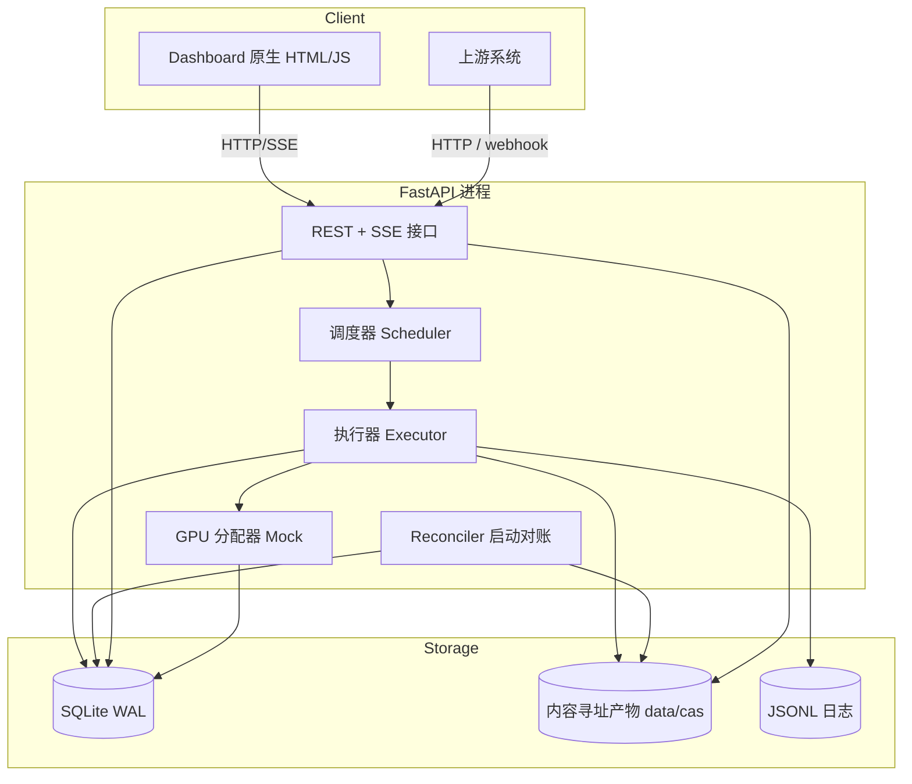
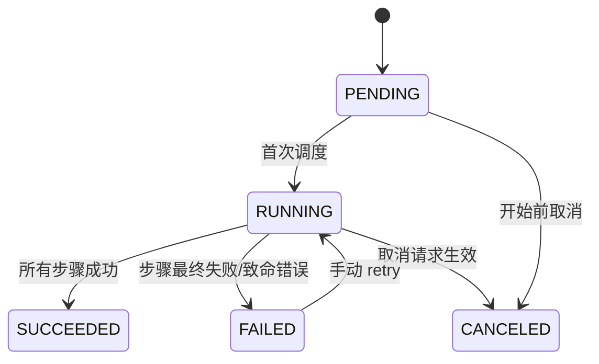
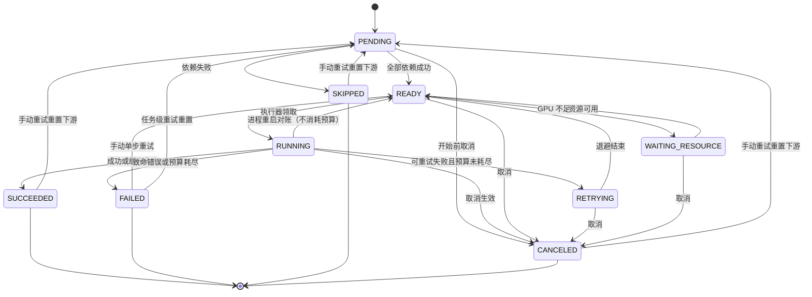

# 可观测 AI 任务执行管线 MVP —— 需求与设计规格

| 项目 | 内容 |
|---|---|
| 文档版本 | v1.0（设计已确认） |
| 日期 | 2026-10-25 |
| 状态 | 待用户评审 → 进入实现计划 |
| 技术栈 | Python 3.11+ / FastAPI / SQLite（WAL）/ 原生 HTML+JS |
| 交付形式 | 公开 GitHub 仓库 + 本地一条命令运行（含 Docker） |

---

## 1. 背景与目标

### 1.1 背景

需求方要求设计一个**支持可观测的 AI 任务执行管线 MVP**。以「一个动画素材处理任务」为例：任务由多个耗时步骤组成，需要在单步骤失败、执行进程中断、任务长时间运行等情况下合理恢复并继续执行，同时让上游随时看到任务与各步骤的执行状态。

评分导向明确：**同等结果下，更简单、更可控、更容易解释正确性的方案得分更高**。

### 1.2 目标

1. 提供可运行的 MVP：任务提交 → 多步骤执行 → 状态可查 → 失败可恢复 → 结果可复用。
2. 用状态机 + 持久化检查点 + 内容寻址产物，让每一次恢复行为都能从数据推导、解释、复现。
3. 提供 Dashboard 与 REST/SSE 接口，满足「上游可见」。
4. 在文档中覆盖秒级 → 小时级的演进设计，以及 GPU 任务的调度与可观测性（MVP 层用 Mock 实现）。

### 1.3 成功标准

- 评审者按 README 一条命令启动，5 分钟内完成正常执行、失败重试、进程崩溃恢复、缓存复用四类演示。
- 所有验收标准（第 19 章）可由自动化测试或演示脚本验证。
- 最终交付的 Markdown 说明覆盖需求方列出的全部问题（第 21 章）。

---

## 2. 范围

### 2.1 In Scope

| 编号 | 内容 |
|---|---|
| S-01 | 声明式 Pipeline 定义（步骤、依赖、GPU 需求、重试/超时策略） |
| S-02 | 任务/步骤/尝试三级状态机与持久化 |
| S-03 | 进程内执行器：就绪调度、并发控制、心跳与租约 |
| S-04 | 步骤级重试、断点恢复、基于内容指纹的结果复用 |
| S-05 | 执行进程崩溃后的自动对账与续跑 |
| S-06 | 任务取消、步骤超时 |
| S-07 | 内容寻址产物存储与下载 |
| S-08 | REST 查询/操作接口、SSE 实时推送、执行历史事件流 |
| S-09 | Web Dashboard（任务列表、任务详情、时间线、GPU 面板、总览） |
| S-10 | Mock GPU 资源调度、排队、显存回收与利用率展示 |
| S-11 | 结构化日志、Prometheus 指标、trace 关联、上游回调 |
| S-12 | 动画素材处理 Mock Pipeline（7 个步骤） |
| S-13 | 崩溃/失败/缓存/GPU 场景演示脚本与自动化测试 |
| S-14 | Docker 化、一键启动、README 与设计说明 |

### 2.2 Out of Scope（非目标）

- 真实 AI 模型推理、真实 GPU 计算、真实视频处理。
- 多节点分布式调度、跨机器 worker、消息队列中间件。
- 多租户、鉴权、权限体系（默认仅本机访问）。
- 精确一次（exactly-once）的外部副作用；MVP 用幂等键 + outbox 达到可接受的「效果一次」。
- 产物长期归档、成本计费、告警平台对接（在演进章节说明，不在 MVP 实现）。

### 2.3 设计约束

- 不引入消息队列、工作流引擎、ORM。核心依赖保持最小：FastAPI、uvicorn、pydantic、httpx、prometheus_client、pytest。
- 所有关键行为（恢复、重试、复用）必须有可观测证据（DB 状态、事件、日志），不能只靠日志文本解释。
- Mock 任务实际耗时通过配置调整，默认总时长约 7 秒；演示脚本可用 `slow_steps` 放大到 20–40 秒。

---

## 3. 角色与用户故事

| 角色 | 用户故事 |
|---|---|
| 上游业务系统 | 提交任务后拿到 task_id；通过 API/webhook 获知终态与失败原因；可查询每个步骤的进度与产物。 |
| 运维/开发者 | 进程意外退出后重启服务即可自动续跑；能定位失败步骤、查看每次尝试的错误与日志；能针对单步骤重试。 |
| 评审者 | 一条命令启动，按演示脚本观察正常、重试、崩溃恢复、缓存复用、GPU 排队五类场景。 |
| 资源管理者 | 看到 GPU 设备的显存占用、排队步骤与利用率，理解任务为何未开始执行。 |

---

## 4. 功能需求

### 4.1 任务与 Pipeline

- **FR-01 创建任务**：`POST /api/tasks` 接收 pipeline 名称、版本、参数、可选回调地址，返回 task_id，状态 `PENDING`。
- **FR-02 声明式 Pipeline**：Pipeline 以 JSON 定义，包含名称、版本、步骤列表。每个步骤声明：
  - `name`（任务内唯一）
  - `depends_on`（步骤名数组，允许 DAG）
  - `handler`（Mock 处理器标识）
  - `gpu`（可选：`count`、`memory_mb`）
  - `retry`（`max_attempts`、`backoff_base_ms`、`backoff_max_ms`、`retry_on`）
  - `timeout_s`
  - `outputs`（产物名称列表）
  - `config`（静态业务参数）
  - `params`（任务参数绑定，如 `{"source": "$task.source"}`；解析后与 `config` 合并为**有效配置**参与指纹计算）
- **FR-03 依赖调度**：步骤仅在其所有依赖步骤 `SUCCEEDED` 后进入 `READY`；依赖失败或取消时，下游步骤置 `SKIPPED`。
- **FR-04 示例 Pipeline**：`animated-asset@v1`，步骤与依赖见第 6 章。

### 4.2 执行与状态

- **FR-05 执行器**：进程内后台执行器轮询 `READY` 步骤，受最大并发数（默认 2）与 GPU 资源约束后执行。
- **FR-06 三层状态**：Task / Step / Attempt 状态定义见第 8 章；任何状态变更必须在同一数据库事务中写入 `events`。
- **FR-07 心跳与租约**：执行中的 attempt 每 10 秒续租，租约 30 秒过期；执行器定期刷新 `lease_expires_at`。
- **FR-08 步骤超时**：单次 attempt 超过 `timeout_s` 后被判定失败，按重试策略处理；执行资源被释放。
- **FR-09 取消**：`POST /api/tasks/{id}/cancel` 置取消标志；执行器在步骤检查点（步骤边界与心跳周期）退出运行中步骤，已完成步骤产物保留，任务终态 `CANCELED`。

### 4.3 失败恢复与结果复用

- **FR-10 步骤级重试**：可重试错误按指数退避 + 抖动重试，退避上限可配置；耗尽预算后步骤 `FAILED`、任务 `FAILED`。
- **FR-11 错误分类**：错误必须分类为 `RETRYABLE`、`FATAL`、`CRASH` 三类，行为见第 9 章失败矩阵。
- **FR-12 崩溃恢复**：服务启动时运行 reconciler：
  1. 单进程 MVP 中，启动时所有 `RUNNING` attempt 都属于已退出的上个进程，标为 `ABANDONED`（多实例部署时才改为按租约过期判定）；
  2. 对应步骤回到 `READY`，任务保持 `RUNNING`；
  3. 清理未提交的临时产物；
  4. 写入 `recovery.resumed` 事件；
  5. 崩溃恢复**不消耗**重试预算（与业务失败区分）。
- **FR-13 断点续跑**：恢复时只从最后一个 `SUCCEEDED` 步骤之后执行；已成功步骤不重复执行。
- **FR-14 结果复用**：步骤指纹 = `sha256(canonical_json(pipeline@version, step name, step config, sorted(依赖产物 sha256), handler version))`。执行前查询 `step_cache`：
  - 命中且产物文件存在、sha256 校验通过 → 创建产物引用，步骤直接 `SUCCEEDED`，标记 `reused=true`，写 `step.cache_hit` 事件；
  - 命中但文件缺失/校验失败 → 视为未命中，正常执行；
  - 成功后写回 `step_cache`。
- **FR-15 手动重试**：`POST /api/tasks/{id}/retry` 恢复失败任务（从失败步骤继续）；`POST /api/tasks/{id}/steps/{name}/retry` 重置指定失败步骤并续跑。手动重试重置该步骤的重试预算。
- **FR-16 原子产物**：产物先写临时文件，`fsync` 后原子 rename 到 CAS 路径；DB 事务提交前校验文件存在与哈希一致，避免「有状态无产物」。

### 4.4 查询、可视化与可观测性

- **FR-17 查询 API**：任务列表/详情/步骤/尝试/事件/产物/GPU 状态，见第 13 章。
- **FR-18 实时推送**：`GET /api/tasks/{id}/stream` 提供 SSE，按事件增量推送任务状态；断线后客户端可用 `Last-Event-ID` 续传。
- **FR-19 Dashboard**：任务列表、任务详情（DAG/步骤状态、尝试时间线、错误与日志、重试/取消、产物下载）、GPU 面板、总览指标。
- **FR-20 事件历史**：所有状态变更、重试、恢复、缓存命中、GPU 排队/租约、回调写入 `events`，作为时间线唯一事实来源。
- **FR-21 指标**：`/metrics` 暴露任务/步骤状态计数、步骤耗时直方图、重试计数、缓存命中计数、GPU 显存占用与排队数。
- **FR-22 日志**：每次 attempt 一个 JSONL 日志文件，包含 task_id、step、attempt_no、trace_id、span_id、时间戳、级别、消息。
- **FR-23 上游回调**：任务进入终态后，按 `callback_url` 发送 webhook；使用 outbox 表与幂等键（task_id + 终态）保证重试不重复产生业务影响；失败按退避重试并记录事件。

### 4.5 GPU Mock

- **FR-24 设备模型**：配置虚拟设备（默认 1 张，8192 MB）；步骤通过 `gpu` 字段申请显存与设备数。
- **FR-25 资源调度**：显存不足时步骤进入 `WAITING_RESOURCE`，记录排队原因与顺序，不消耗重试预算；资源释放后按 FIFO 唤醒。
- **FR-26 显存回收**：GPU 租约随 attempt 续租，attempt 结束或租约过期后释放，避免进程崩溃造成显存「泄漏」。
- **FR-27 OOM 注入**：当步骤申请显存超过设备总量时抛出 `CUDA_OOM`（分类为可重试），用于演示失败与重试行为；可通过配置关闭。
- **FR-28 GPU 可观测**：`GET /api/gpu` 返回设备、已用/总显存、持有者、排队列表、模拟利用率；Dashboard 实时展示。

### 4.6 演示流水线

- **FR-29 Mock 步骤**：7 个步骤均为 Mock，按配置模拟耗时与失败注入；支持环境变量/请求参数注入「第 N 次尝试失败」「致命失败」「崩溃」等故障。
- **FR-30 演示脚本**：提供脚本覆盖正常执行、瞬时失败重试、致命失败、`kill -9` 恢复、缓存复用、GPU 排队/OOM。

---

## 5. 非功能需求

- **NFR-01 一键运行**：`docker compose up` 或 `make run` 启动；无需外部数据库/缓存；首次启动自动建表。
- **NFR-02 可解释性**：任何任务状态都可由 `tasks + steps + step_attempts + events + artifacts` 推导；不得存在仅存于内存的关键状态。
- **NFR-03 时延**：默认 Mock 任务约 7 秒完成（演示可通过 `slow_steps` 放大到 20–40 秒）；API P95 < 100 ms（本地）；Dashboard 状态刷新延迟 ≤ 2 秒。
- **NFR-04 一致性**：状态变更与事件写入同事务；产物落盘与状态提交保持一致或可对账修复。
- **NFR-05 可测试性**：核心状态机、指纹、重试策略、恢复对账具备单元测试；关键场景具备集成测试；整体覆盖率目标 ≥ 70%（核心模块 ≥ 85%）。
- **NFR-06 可维护性**：按 API / 执行器 / 调度 / 存储 / 可观测性分层；单个文件不超过约 400 行；关键决策在代码注释或文档中可追溯。
- **NFR-07 安全边界**：默认绑定 `127.0.0.1`；不执行用户上传的可执行代码；pipeline 定义仅来自仓库内受控文件。
- **NFR-08 可移植性**：Linux/macOS/Windows（Docker 为准）；Python 3.11+；SQLite ≥ 3.35。
- **NFR-09 资源占用**：空载内存 < 200 MB；演示数据可清理，提供 `make reset`。
- **NFR-10 时间语义**：存储使用 UTC；耗时统计使用单调时钟；租约判断容忍合理时钟偏差。

---

## 6. 示例任务与 Pipeline 定义

### 6.1 任务场景

输入一段动画素材（GIF/视频/序列帧），执行去背景、风格化、超分、合成精灵图，最终产出可发布的动画素材包。所有步骤为 Mock，但步骤边界、资源需求、耗时量级按真实 AI Pipeline 设计。

### 6.2 步骤 DAG


| 步骤 | 类型 | 典型耗时 | GPU | 产物 | 拆分/恢复考量 |
|---|---|---|---|---|---|
| `ingest` | CPU | 1–2 s | 否 | `manifest.json` | 快，不拆分；校验输入与元信息 |
| `extract_frames` | CPU | 3–6 s | 否 | `frames/*.png`、`frame_index.json` | 小时级场景按帧区间分段 |
| `segment_subject` | GPU | 5–8 s | 1×2048 MB | `masks/*.png` | 逐帧/分批可恢复，适合独立任务 |
| `style_transfer` | GPU | 6–10 s | 1×3072 MB | `styled/*.png` | 最昂贵步骤，必须可分段 checkpoint |
| `upscale` | GPU | 4–7 s | 1×2560 MB | `upscaled/*.png` | 逐帧幂等，可独立重试 |
| `compose_spritesheet` | CPU | 2–4 s | 否 | `spritesheet.png`、`preview.gif` | 依赖全部帧，适合最后聚合 |
| `publish` | CPU | 1–2 s | 否 | `bundle.json`、`checksums.txt` | 有外部副作用，必须幂等 |

### 6.3 Pipeline 定义示例

```json
{
  "name": "animated-asset",
  "version": "1",
  "steps": [
    {
      "name": "ingest",
      "depends_on": [],
      "handler": "mock.ingest",
      "params": {"source": "$task.source"},
      "outputs": ["manifest.json"],
      "retry": {"max_attempts": 2, "backoff_base_ms": 500, "backoff_max_ms": 4000, "retry_on": ["RETRYABLE"]},
      "timeout_s": 30
    },
    {
      "name": "extract_frames",
      "depends_on": ["ingest"],
      "handler": "mock.extract_frames",
      "params": {"target_fps": "$task.target_fps"},
      "outputs": ["frames/index.json"],
      "retry": {"max_attempts": 3, "backoff_base_ms": 1000, "backoff_max_ms": 10000, "retry_on": ["RETRYABLE"]},
      "timeout_s": 120
    },
    {
      "name": "segment_subject",
      "depends_on": ["extract_frames"],
      "handler": "mock.segment_subject",
      "gpu": {"count": 1, "memory_mb": 2048},
      "outputs": ["masks/index.json"],
      "retry": {"max_attempts": 3, "backoff_base_ms": 1000, "backoff_max_ms": 15000, "retry_on": ["RETRYABLE"]},
      "timeout_s": 180
    },
    {
      "name": "style_transfer",
      "depends_on": ["segment_subject"],
      "handler": "mock.style_transfer",
      "params": {"style": "$task.style"},
      "gpu": {"count": 1, "memory_mb": 3072},
      "outputs": ["styled/index.json"],
      "retry": {"max_attempts": 2, "backoff_base_ms": 2000, "backoff_max_ms": 20000, "retry_on": ["RETRYABLE"]},
      "timeout_s": 240
    },
    {
      "name": "upscale",
      "depends_on": ["style_transfer"],
      "handler": "mock.upscale",
      "gpu": {"count": 1, "memory_mb": 2560},
      "outputs": ["upscaled/index.json"],
      "retry": {"max_attempts": 3, "backoff_base_ms": 1000, "backoff_max_ms": 15000, "retry_on": ["RETRYABLE"]},
      "timeout_s": 180
    },
    {
      "name": "compose_spritesheet",
      "depends_on": ["upscale"],
      "handler": "mock.compose_spritesheet",
      "outputs": ["spritesheet.png", "preview.gif"],
      "retry": {"max_attempts": 2, "backoff_base_ms": 500, "backoff_max_ms": 5000, "retry_on": ["RETRYABLE"]},
      "timeout_s": 120
    },
    {
      "name": "publish",
      "depends_on": ["compose_spritesheet"],
      "handler": "mock.publish",
      "outputs": ["bundle.json", "checksums.txt"],
      "retry": {"max_attempts": 3, "backoff_base_ms": 1000, "backoff_max_ms": 10000, "retry_on": ["RETRYABLE"]},
      "timeout_s": 60
    }
  ]
}
```

### 6.4 依赖关系的语义

1. **数据依赖**：步骤的输入由其依赖步骤的产物快照确定；依赖产物进入指纹，任何上游变化都会使缓存失效。
2. **执行依赖**：所有依赖 `SUCCEEDED` 才可调度；任一依赖终态为 `FAILED/CANCELED/SKIPPED`，下游 `SKIPPED`。
3. **资源依赖**：GPU 申请不构成 DAG 边，只影响调度排队。
4. **DAG 允许并行**：MVP 示例为链式，但调度器按就绪集执行，天然支持分叉并行（如未来 style_transfer 与 upscale 并行分支）。
5. **任务参数绑定**：步骤的 `params` 把任务参数映射为步骤配置；未声明绑定的任务参数不会影响该步骤指纹。Pipeline 定义必须为实际影响计算的参数声明绑定（如 `source`、`style`、`target_fps`），否则不同参数会错误复用缓存。
6. **有效配置**：`config` 与解析后的 `params` 合并为有效配置，是指纹与 handler 执行的共同输入；定义加载时校验绑定引用存在，缺失参数直接拒绝创建任务。

---

## 7. 系统架构



### 7.1 组件职责

| 组件 | 职责 | 不做什么 |
|---|---|---|
| API 层 | 参数校验、查询、取消/重试指令、SSE、Dashboard 静态资源 | 不直接执行业务步骤 |
| 调度器 | 计算就绪集、并发上限、GPU 资源准入、FIFO 排队 | 不关心步骤内部实现 |
| 执行器 | 领取步骤、写 attempt、心跳、超时、执行 handler、提交产物与状态 | 不直接拼装响应 |
| GPU 分配器 | 显存记账、租约、排队、模拟利用率 | 不调度 CPU 步骤 |
| Reconciler | 启动时清理过期租约、续跑、清理临时产物、缓存校验 | 不做业务重试决策 |
| 存储层 | 事务、状态读写、事件追加、CAS 读写 | 不含业务规则 |
| 可观测层 | 日志、指标、事件、trace 关联、webhook outbox | 不改变任务状态 |

### 7.2 并发模型

- FastAPI 异步事件循环承载 HTTP 与 SSE。
- 执行器为后台任务：单个调度循环 + 有界执行线程/协程池（默认 2 并发）。
- SQLite 采用「单写多读」：写操作经一个写锁串行化，事务短小；读连接独立，启用 WAL 与 `busy_timeout`。
- 心跳由执行器监督协程统一续租，避免 CPU 密集步骤阻塞续租。

---

## 8. 状态机

### 8.1 Task 状态



- `PENDING`：已创建，尚未开始执行。
- `RUNNING`：至少一个步骤已开始或已排队。
- `SUCCEEDED`：所有步骤 `SUCCEEDED` 或合法 `SKIPPED`。
- `FAILED`：存在步骤 `FAILED` 且无可用重试预算。
- `CANCELED`：取消已生效。
- 取消请求用 `cancel_requested` 布尔字段表达，任务状态在结束时写 `CANCELED`。

### 8.2 Step 状态



> 说明：缓存命中直接由 `READY → RUNNING（短暂）→ SUCCEEDED`，并写 `step.cache_hit` 事件；实现上可合并为一次事务提交，但事件必须保留。

### 8.3 Attempt 状态

| 状态 | 含义 |
|---|---|
| `RUNNING` | 正在执行，持有租约 |
| `SUCCEEDED` | 本次尝试成功 |
| `FAILED` | 本次尝试失败（含超时、OOM 等业务/资源错误） |
| `ABANDONED` | 租约过期，推定执行进程失联 |
| `CANCELED` | 用户取消导致中止 |

### 8.4 状态不变量

1. 同一时刻一个步骤最多一个 `RUNNING` attempt。
2. 步骤 `SUCCEEDED` 当且仅当存在对应成功 attempt 或缓存命中记录，且产物校验通过。
3. 任务 `SUCCEEDED` 时，所有步骤必须为 `SUCCEEDED`（无 `SKIPPED` 的合法场景除外；MVP 示例无 SKIPPED）。
4. 任何状态迁移必须与事件写入同事务。
5. `RUNNING` attempt 必须有未过期的租约，否则由 reconciler 处理。

---

## 9. 失败、重试与恢复

### 9.1 错误分类

| 分类 | 示例 | 是否重试 | 是否消耗预算 |
|---|---|---|---|
| `RETRYABLE` | 超时、临时 IO、`CUDA_OOM`、上游回调 5xx | 是 | 是 |
| `FATAL` | 输入非法、配置错误、确定性处理失败 | 否 | 不适用 |
| `CRASH` | 进程被杀、租约过期、工作线程异常退出 | 是（恢复） | 否 |

### 9.2 重试预算语义

- `max_attempts` 指该步骤最多执行次数（含首次执行）。
- `retry_count` 只统计**业务可重试失败**（`RETRYABLE`）消耗的次数；`CRASH`/`ABANDONED` 恢复不计入。
- 当业务可重试失败次数达到 `max_attempts - 1` 时预算耗尽，步骤转 `FAILED`；手动重试将 `retry_count` 归零。
- `attempt_no` 为真实执行序号，包含崩溃恢复产生的 attempt，用于审计，不等同于重试预算。

### 9.3 行为矩阵

| 场景 | 检测方式 | 系统行为 | 上游可见状态 |
|---|---|---|---|
| 步骤瞬时错误 | handler 抛可重试异常 | attempt=`FAILED`；step=`RETRYING`；指数退避后新 attempt | 重试次数、错误码、next_retry_at |
| 步骤致命错误 | handler 抛致命异常 | attempt=`FAILED`；step=`FAILED`；下游 `SKIPPED`；task=`FAILED` | 失败步骤、错误码、日志路径 |
| 重试预算耗尽 | attempt 计数达上限 | step=`FAILED`；task=`FAILED` | 全部 attempt 历史 |
| 执行进程 `kill -9` | 启动对账（单进程即视为孤儿）；多实例按租约 30 s 过期 | attempt=`ABANDONED`；重启后 step 回 `READY` 续跑；不消耗预算 | `recovery.resumed` 事件 |
| 单步骤卡死 | 超过 `timeout_s` | 中止 attempt；按可重试处理 | 超时错误 + 重试 |
| 用户取消 | cancel 接口 | 当前步骤中止；已完成产物保留；未开始步骤 `CANCELED`；task=`CANCELED` | 取消时间与保留产物 |
| 已完成步骤再次需要 | 指纹命中 | 秒级复用，不执行 handler | step 标记 `reused`，`step.cache_hit` |
| 缓存文件损坏 | 执行前校验 sha256 | 视为未命中并重新执行；写告警事件 | 缓存校验失败原因 |
| GPU 显存不足 | 分配器拒绝 | step=`WAITING_RESOURCE`；FIFO 排队；不消耗预算 | 排队位置与所需显存 |
| GPU 任务 OOM | handler 模拟/真实异常 | `CUDA_OOM` 按可重试处理 | attempt 错误码与显存信息 |
| 回调失败 | HTTP 非 2xx/超时 | outbox 退避重试；幂等键防重复 | `callback.failed` / `callback.sent` |
| 产物写入后进程崩溃 | 启动校验 CAS 与 DB | 有产物无状态：可复用则接管；有状态无产物：置失败并重跑 | 对账事件 |

### 9.4 恢复算法（启动对账）

```text
# 单进程 MVP：启动时所有 RUNNING attempt 均来自已退出进程；
# 多实例部署时改为 RUNNING with lease_expires_at < now。
for each attempt in RUNNING (startup) or RUNNING with lease_expires_at < now (multi-instance):
    mark attempt ABANDONED
    emit event step.attempt.abandoned
    if task.cancel_requested: mark step/task CANCELED
    else: mark step READY (retry budget unchanged)
         emit event recovery.resumed

for each task in RUNNING:
    recompute ready set; schedule

for each tmp artifact dir older than TTL:
    delete

for each cache entry referenced by ready step:
    verify file exists and sha256 matches; else drop entry

release expired GPU leases; emit gpu.released(reason=lease_expired)
drain outbox for terminal tasks (idempotent)
```

### 9.5 原子性与一致性策略

1. **产物**：写 `data/tmp/<uuid>` → `fsync` → 原子 rename 到 `data/cas/<sha256>`。CAS 中已存在同哈希文件则校验后复用。
2. **状态**：一个步骤成功后，先完成产物落盘，再在单个事务内写 artifacts、step、events、step_cache。
3. **崩溃窗口处理**：若产物已 rename 但事务未提交，下次执行同一步骤时指纹相同，直接接管 CAS 文件，不重复计算；由对账逻辑校验并补记。
4. **回调**：终态事务内写 outbox 记录；独立发送循环按幂等键投递，成功后标记 sent。

---

## 10. 结果复用设计

### 10.1 指纹定义

```text
fingerprint = sha256(canonical_json({
  "pipeline": "<name>@<version>",
  "step": "<step name>",
  "config": <有效配置：静态 config + 解析后的 params 绑定，规范化 JSON>,
  "inputs": [<依赖步骤所有产物的 sha256，升序>],
  "handler_version": "<handler 实现版本常量>"
}))
```

- `handler_version` 在 Mock 处理器或真实模型/预处理逻辑变更时递增，避免错误复用旧结果。
- 输入取「依赖产物的内容哈希」而非路径或时间，天然支持跨任务复用与去重。
- 任务参数只通过步骤 `params` 绑定进入有效配置；这保证「参数变化 → 指纹变化 → 缓存失效」，同时允许无关参数不干扰缓存。
- 指纹计算前对 JSON 做规范化（键排序、去除空白、统一数字表示），保证同内容同指纹。

### 10.2 复用规则

1. 仅复用 `step_cache` 中来自成功执行的记录。
2. 复用前校验产物存在且哈希一致；否则删除缓存记录并重新执行。
3. 复用命中后，为当前任务创建产物引用（CAS 天然共享，不复制大文件），步骤标记 `reused=true`。
4. 事件记录 `step.cache_hit`，指标 `pipeline_cache_hits_total` 自增。
5. 手动重试可选择 `force=true` 绕过缓存（用于验证或修复场景）；默认仍优先复用。

---

## 11. 数据模型与持久化选择

### 11.1 存储布局

```text
data/
  app.db                 # SQLite（WAL）
  cas/<sha256>           # 内容寻址产物（去重）
  tmp/<uuid>/            # 写入中的临时产物
  logs/<task_id>/<step>/attempt-<n>.jsonl
```

### 11.2 表结构

#### tasks

| 字段 | 类型 | 说明 |
|---|---|---|
| id | TEXT PK | ULID/UUID |
| pipeline_name | TEXT | 如 animated-asset |
| pipeline_version | TEXT | 版本 |
| params_json | TEXT | 业务参数 |
| status | TEXT | 状态机 |
| cancel_requested | INTEGER | 0/1 |
| callback_url | TEXT NULL | 上游回调 |
| trace_id | TEXT | 贯穿日志/事件 |
| error_code / error_message | TEXT NULL | 终态错误摘要 |
| created_at / started_at / finished_at | TEXT | UTC ISO8601 |
| updated_at | TEXT | 乐观并发/查询用 |

#### steps

| 字段 | 类型 | 说明 |
|---|---|---|
| id | TEXT PK | |
| task_id | TEXT FK | |
| name | TEXT | 任务内唯一 |
| status | TEXT | 状态机 |
| depends_on_json | TEXT | 依赖列表 |
| config_json | TEXT | 有效配置（静态 config + 解析后的 params 绑定） |
| fingerprint | TEXT NULL | 成功/执行前计算 |
| retry_max | INTEGER | 预算 |
| retry_count | INTEGER | 已消耗业务重试次数 |
| gpu_count / gpu_memory_mb | INTEGER | 资源需求 |
| reused | INTEGER | 是否缓存命中 |
| error_class / error_code | TEXT NULL | 错误分类 |
| progress | INTEGER | 0–100，best-effort |
| started_at / finished_at | TEXT NULL | |
| updated_at | TEXT | |

唯一索引 `(task_id, name)`。

#### step_attempts

| 字段 | 类型 | 说明 |
|---|---|---|
| id | TEXT PK | |
| step_id | TEXT FK | |
| attempt_no | INTEGER | 从 1 递增 |
| status | TEXT | RUNNING/SUCCEEDED/FAILED/ABANDONED/CANCELED |
| error_class / error_code / error_message | TEXT NULL | |
| log_path | TEXT | JSONL 路径 |
| metrics_json | TEXT | 耗时、模拟显存峰值等 |
| worker_id | TEXT | 执行器实例标识 |
| lease_expires_at | TEXT | 租约 |
| started_at / finished_at | TEXT | |

唯一索引 `(step_id, attempt_no)`。

#### artifacts

| 字段 | 类型 | 说明 |
|---|---|---|
| id | TEXT PK | |
| task_id | TEXT FK | |
| step_id | TEXT FK | |
| name | TEXT | 产物逻辑名 |
| sha256 | TEXT | CAS 键 |
| size_bytes | INTEGER | |
| mime | TEXT | |
| created_at | TEXT | |

索引 `(task_id)`、`(sha256)`。

#### step_cache

| 字段 | 类型 | 说明 |
|---|---|---|
| fingerprint | TEXT PK | 指纹 |
| artifacts_json | TEXT | `[{name, sha256, size}]` |
| pipeline_name / step_name | TEXT | 便于排查 |
| hit_count | INTEGER | 复用次数 |
| created_at / last_used_at | TEXT | GC 依据 |

#### events

| 字段 | 类型 | 说明 |
|---|---|---|
| id | INTEGER PK AUTOINCREMENT | SSE Last-Event-ID |
| task_id | TEXT | |
| step_id | TEXT NULL | |
| attempt_id | TEXT NULL | |
| type | TEXT | 见事件类型 |
| payload_json | TEXT | 细节 |
| trace_id / span_id | TEXT | 关联 |
| created_at | TEXT | |

索引 `(task_id, id)`。

#### gpu_leases

| 字段 | 类型 | 说明 |
|---|---|---|
| id | TEXT PK | |
| device_id | TEXT | 虚拟设备 |
| attempt_id | TEXT FK | 持有者 |
| memory_mb | INTEGER | |
| acquired_at / expires_at / released_at | TEXT | |
| release_reason | TEXT NULL | finished/lease_expired/canceled |

#### outbox

| 字段 | 类型 | 说明 |
|---|---|---|
| id | TEXT PK | |
| task_id | TEXT | |
| event | TEXT | 如 task.succeeded |
| url | TEXT | |
| idempotency_key | TEXT UNIQUE | task_id + 终态 |
| payload_json | TEXT | |
| status | TEXT | pending/sent/failed |
| attempts | INTEGER | |
| next_attempt_at / created_at / sent_at | TEXT | |
| last_error | TEXT NULL | |

### 11.3 持久化取舍说明

| 数据 | 是否持久化 | 原因 |
|---|---|---|
| 任务/步骤主状态 | 是 | 恢复与查询的根；进程重启后必须可继续 |
| attempt 历史 | 是 | 重试计量、崩溃判定、审计与时间线 |
| 依赖与配置 | 是 | 决定就绪集与指纹；必须可重建调度 |
| 指纹与缓存索引 | 是 | 结果复用的依据；跨任务复用 |
| 产物内容 | 是（CAS） | 结果复用与下载；内容寻址便于校验去重 |
| 事件流 | 是 | 唯一事实来源，支撑 SSE/时间线/复盘 |
| GPU 租约 | 是 | 崩溃后回收；可观测性 |
| outbox | 是 | 回调不丢不重 |
| 进度百分比 | 是（弱一致） | 仅供展示，丢失可接受；不作为恢复依据 |
| 执行堆栈/详细日志 | 文件 | 体量大，DB 只存索引路径 |
| 瞬时调度队列 | 否 | 可由状态与依赖重建，避免双写不一致 |

---

## 12. 存储与并发实现约束

- SQLite 开启 `journal_mode=WAL`、`synchronous=NORMAL`、`busy_timeout=5000`、`foreign_keys=ON`。
- 单一写连接 + 进程内写锁，事务保持毫秒级；读连接按查询创建或使用只读连接池。
- 所有时间存 UTC ISO8601；耗时使用 `time.monotonic()` 计算。
- 建表与索引通过 `schema.sql` 初始化；启动时执行轻量迁移检查（版本表）。
- 数据清理：`make reset` 删除 `data/`；提供手动 CAS GC 脚本（按 events/cache 引用判定）。

---

## 13. API 设计

### 13.1 任务

```http
POST /api/tasks
Content-Type: application/json

{
  "pipeline": "animated-asset",
  "version": "1",
  "params": {"source": "demo/sample.gif", "style": "watercolor", "target_fps": 12},
  "callback_url": "https://example.com/hooks/pipeline"
}
```

```json
{
  "id": "01J...",
  "status": "PENDING",
  "links": {
    "self": "/api/tasks/01J...",
    "events": "/api/tasks/01J.../events",
    "stream": "/api/tasks/01J.../stream"
  }
}
```

| 方法与路径 | 说明 |
|---|---|
| `GET /api/tasks?status=&limit=&cursor=` | 任务列表，按创建时间倒序 |
| `GET /api/tasks/{id}` | 任务详情 + 步骤摘要 + 进度 |
| `GET /api/tasks/{id}/steps` | 步骤列表（含依赖、状态、错误、reused） |
| `GET /api/tasks/{id}/steps/{name}/attempts` | 尝试历史 |
| `GET /api/tasks/{id}/events?after=` | 事件时间线 |
| `GET /api/tasks/{id}/stream` | SSE；支持 `Last-Event-ID` |
| `POST /api/tasks/{id}/cancel` | 取消 |
| `POST /api/tasks/{id}/retry` | 恢复失败任务 |
| `POST /api/tasks/{id}/steps/{name}/retry` | 单步重试；body 可选 `{"force": true}` |
| `GET /api/tasks/{id}/artifacts` | 产物列表 |
| `GET /api/artifacts/{id}` | 元信息 |
| `GET /api/artifacts/{id}/download` | 下载（流式） |
| `GET /api/gpu` | 设备、租约、排队、利用率 |
| `GET /api/overview` | 总览指标 |
| `GET /metrics` | Prometheus 文本 |
| `GET /healthz` | 健康检查（含 DB 可写、执行器存活） |

### 13.2 错误响应

统一结构：

```json
{
  "error": {
    "code": "TASK_NOT_CANCELABLE",
    "message": "task is already succeeded",
    "details": {}
  }
}
```

- 参数错误 `400`；不存在 `404`；状态冲突 `409`；内部错误 `500`。
- 重试/取消为幂等操作：重复调用返回当前状态并附 `already_applied: true`。

### 13.3 SSE 事件格式

```text
id: 128
event: step
data: {"task_id":"01J...","step":"style_transfer","status":"RUNNING","attempt":1,"ts":"..."}
```

- 事件类型：`task`、`step`、`attempt`、`gpu`、`heartbeat`。
- 每 15 秒发送一次 keepalive 注释帧。
- 客户端断线重连时携带 `Last-Event-ID`，服务端补发缺失事件。

---

## 14. Dashboard 设计

技术：静态 HTML + CSS + 原生 JS，通过 `fetch` + `EventSource` 访问 API；无前端构建链，保证一键运行。

### 14.1 页面

1. **任务列表 `/`**
   - 状态筛选、分页（游标）
   - 每行：task_id 短码、状态徽章、进度条、耗时、当前步骤、是否含缓存复用
   - 顶部「新建演示任务」按钮（固定示例参数）
2. **任务详情 `/tasks/{id}`**
   - 步骤图：按 DAG 布局的卡片，状态着色；显示 reused、GPU 需求、耗时、attempt 数
   - 尝试时间线：每次 attempt 的起止、错误分类、错误码、日志查看
   - 事件流：可读文本 + 原始 JSON 切换
   - 操作：取消、重试失败步骤、下载产物
   - 失败时显著展示失败步骤、错误码与建议动作
3. **GPU 面板 `/gpu`**
   - 设备显存条形图（已用/总量）
   - 当前租约持有者与剩余时间
   - 排队列表（步骤、请求显存、等待时长）
   - 模拟利用率折线（最近 60 秒）
4. **总览 `/overview`**（可与列表页合并）
   - 任务状态计数、成功率、平均耗时、重试率、缓存命中率

### 14.2 交互与刷新

- 详情页使用 SSE；列表/GPU/总览使用 2 秒轮询。
- 状态颜色：灰=PENDING、蓝=READY/WAITING、黄=RUNNING/RETRYING、绿=SUCCEEDED、红=FAILED、灰划=SKIPPED/CANCELED。
- 所有时间显示本地时区，悬停显示 UTC 原始值。
- 无数据/空错误/加载中均有明确占位。

---

## 15. GPU Mock 设计

### 15.1 设备与分配

- 配置项：`GPU_DEVICES`（默认 `[{id:"gpu0", memory_mb:8192}]`）。
- 分配规则：
  1. 步骤需要 `gpu.count` 张设备、每张 `gpu.memory_mb`；
  2. 找到满足显存余量的设备，写入 `gpu_leases`，attempt 开始执行；
  3. 无满足设备则步骤 `WAITING_RESOURCE`，按申请顺序 FIFO；
  4. attempt 结束/中止/租约过期时释放租约，写 `gpu.released` 事件并唤醒队列。
- 心跳与租约：GPU 租约与执行租约同步续期（10 秒/30 秒）。

### 15.2 模拟指标

- 利用率：每张设备在「有活跃租约」的时间片记为忙碌；按 5 秒窗口计算百分比。
- 显存占用：活跃租约的 `memory_mb` 之和。
- 可注入延迟：分配成功后模拟 200–500 ms 的「加载模型」开销。

### 15.3 OOM 演示

- 步骤请求显存 > 设备总量时，分配器返回 `CUDA_OOM`（可重试），事件记录请求与实际可用。
- 也可通过请求参数 `fail_injections` 指定某步骤第 N 次尝试抛 OOM，演示「重试后成功」。

---

## 16. 可观测性设计

### 16.1 三层证据

| 层 | 内容 | 用途 |
|---|---|---|
| 事件流（DB） | 所有状态变更与关键动作 | 时间线、SSE、审计、复盘 |
| 结构化日志（文件） | 每次 attempt 的详细过程 | 定位失败细节 |
| 指标（Prometheus） | 计数/直方图/瞬时值 | 趋势、告警、GPU 观察 |

### 16.2 事件类型

`task.created`、`task.started`、`task.succeeded`、`task.failed`、`task.canceled`、
`step.ready`、`step.waiting_resource`、`step.attempt.started`、`step.attempt.failed`、
`step.attempt.abandoned`、`step.retrying`、`step.succeeded`、`step.cache_hit`、
`step.failed`、`step.skipped`、`step.canceled`、`recovery.resumed`、
`gpu.queued`、`gpu.leased`、`gpu.released`、`callback.sent`、`callback.failed`。

### 16.3 指标

| 指标 | 类型 | 标签 |
|---|---|---|
| `pipeline_tasks_total` | Counter | status |
| `pipeline_steps_total` | Counter | status, step |
| `pipeline_step_duration_seconds` | Histogram | step, outcome |
| `pipeline_step_attempts_total` | Counter | step, error_class |
| `pipeline_cache_hits_total` | Counter | step |
| `pipeline_gpu_memory_used_mb` | Gauge | device |
| `pipeline_gpu_queue_length` | Gauge | - |
| `pipeline_executor_up` | Gauge | - |
| `pipeline_outbox_pending` | Gauge | - |

### 16.4 trace 关联

- 每个任务生成 `trace_id`；每次 attempt 生成 `span_id`。
- 日志、事件、outbox 均携带 trace_id/span_id，便于串联。
- 预留 OpenTelemetry exporter 接入点（MVP 不强制依赖）。

### 16.5 上游回调

- 终态写入 outbox，`idempotency_key = task_id + ":" + terminal_status`。
- 投递请求头携带 `Idempotency-Key`，body 含任务、步骤摘要、产物清单。
- 非 2xx/超时按指数退避（1s→2s→…→60s，上限 10 次），状态可查。

---

## 17. 秒级 → 小时级：演进设计

当任务从秒级扩展到小时级，以下设计必须改变（MVP 不全部实现，但接口与文档预留）：

| 维度 | 秒级 MVP | 小时级演进 | 原因 |
|---|---|---|---|
| 执行载体 | 进程内执行器 | 独立 worker 进程池 + 队列（Postgres `SKIP LOCKED` 或 Redis） | API 与执行解耦；worker 可水平扩展、独立重启 |
| 租约/心跳 | 10 s / 30 s | 60–120 s 心跳，分钟级租约；分级超时 | GC/网络抖动导致误判；长步骤需要更粗粒度 |
| 步骤粒度 | 整步执行 | 长步骤内部按 chunk 切分 checkpoint（帧区间、分片、批次） | 小时级步骤整步重跑不可接受 |
| 存储 | SQLite | PostgreSQL；连接池、分区、归档 | 并发写、数据量、查询复杂度 |
| 产物 | 本地 CAS | S3/MinIO + 内容寻址 + 生命周期/TTL + GC | 容量、持久性、跨节点共享 |
| 调度 | 内存就绪集 | 持久化队列 + 准入控制、优先级、配额、背压 | 公平性与过载保护 |
| 取消 | 检查点 | 传播到子步骤/子进程，超时强制清理 | 长任务取消需要止损 |
| 回调 | outbox 单实例 | outbox + 去重表 + 多实例抢占 | 至少一次投递下保证效果一次 |
| 可观测 | 事件/日志/指标 | OTel tracing、告警、SLO、成本（GPU 时长） | 小时级故障定位与容量管理 |
| GPU | 进程内模拟分配器 | 设备插件 + 多机队列 + MIG/抢占 + 公平调度 | 真实资源稀缺与隔离 |
| 数据保留 | 手工清理 | 保留策略、冷热分层、审计归档 | 长期运行的数据增长 |

### 17.1 哪些步骤适合作为独立可恢复任务

**判断标准**：耗时长/成本高、幂等、输入输出可物化、可分段、失败影响面可控、可独立调度。

| 步骤 | 是否独立任务 | 理由 |
|---|---|---|
| `ingest` | 否 | 秒级、轻量；拆分只增加状态开销 |
| `extract_frames` | 视规模 | 大素材可按帧区间拆分；小素材保持单步 |
| `segment_subject` | 是 | GPU 昂贵、逐帧幂等，失败重跑成本高 |
| `style_transfer` | 是（且按批次） | 最贵步骤，必须支持分段 checkpoint 与复用 |
| `upscale` | 是 | 逐帧幂等，适合并行与独立重试 |
| `compose_spritesheet` | 否 | 聚合步骤，依赖全部帧；快速且确定性 |
| `publish` | 是（单独步骤） | 有外部副作用；用幂等键保证可重试，而不是随意重跑 |

**反例**：把毫秒级元数据操作拆成独立任务，会让状态管理与调度开销超过计算本身；把有副作用的发布动作混进计算步骤，会导致重试时重复发布。

---

## 18. 技术选型与实现约束

| 项 | 选择 | 理由 |
|---|---|---|
| Web 框架 | FastAPI + uvicorn | 自带 OpenAPI、异步、类型校验 |
| 数据校验 | pydantic v2 | 请求/响应与配置模型 |
| 数据库 | SQLite（stdlib `sqlite3`，WAL） | 零运维、单文件、事务清晰；不引入 ORM 使 SQL 行为可解释 |
| 并发 | asyncio + 有界线程池 | I/O 与阻塞 Mock 兼顾；简单可控 |
| HTTP 客户端 | httpx | 回调投递与测试 |
| 指标 | prometheus_client | 标准文本格式 |
| 前端 | 原生 HTML/CSS/JS + SSE | 无构建链、启动即用 |
| 测试 | pytest + pytest-asyncio + httpx TestClient | 单元/集成/e2e |
| 容器 | Dockerfile + docker-compose | 一键复现 |
| 日志 | JSONL 文件 + 标准库 logging | 易解析、易归档 |

### 18.1 目录结构（计划）

```text
app/
  main.py                # FastAPI 入口、生命周期、后台任务
  api/
    tasks.py  gpu.py  artifacts.py  stream.py  system.py
  core/
    config.py  db.py  schema.sql  logging.py  clock.py
  domain/
    models.py            # 数据类与枚举
    state_machine.py     # 合法迁移与不变量
    fingerprint.py
    pipeline.py          # 定义解析与校验
  execution/
    scheduler.py  executor.py  reconciler.py
    handlers/mock.py     # 7 个 Mock 步骤
    gpu_allocator.py
  observability/
    events.py  metrics.py  callback.py
web/
  index.html  task.html  gpu.html  app.js  style.css
pipelines/
  animated-asset.v1.json
tests/
  unit/  integration/  e2e/
scripts/
  demo_normal.sh  demo_retry.sh  demo_crash.sh
  demo_cache.sh  demo_gpu.sh
data/  logs/
Dockerfile  docker-compose.yml  Makefile  README.md
```

### 18.2 关键实现约定

- 所有状态迁移经 `state_machine.transition()` 校验，非法迁移抛错并记录。
- Handler 接口统一：`run(ctx) -> list[Artifact]`；`ctx` 提供参数、输入产物、进度回调、取消检查、故障注入。
- 故障注入只通过显式配置/请求参数生效，默认关闭，避免演示时误触发。
- 执行器每个步骤在独立线程中运行，主管协程负责心跳/超时/取消信号。
- 服务关闭（SIGTERM）时停止领取新步骤，尽力在宽限期内结束当前步骤；未结束的由下次启动对账恢复。

---

## 19. 测试与验收

### 19.1 测试层次

| 层次 | 内容 |
|---|---|
| 单元 | 状态机合法/非法迁移、指纹稳定性、重试退避序列、错误分类、CAS 校验、outbox 幂等 |
| 集成 | 正常 7 步执行；瞬时失败重试成功；致命失败传播；`kill -9` 后对账续跑；缓存跨任务命中；GPU 排队与 OOM；取消；超时 |
| E2E | 启动服务 → 创建任务 → 轮询/SSE → 校验终态、事件、产物、Dashboard 数据 |
| 演示 | 5 个脚本覆盖核心场景，输出可读结论 |

### 19.2 验收标准

| 编号 | 验收项 | 验证方式 |
|---|---|---|
| AC-01 | `make run` 或 `docker compose up` 一条命令启动，浏览器可访问 Dashboard | 手工 + CI 冒烟 |
| AC-02 | 正常任务 7 步全部成功，产物可下载且 sha256 可校验 | E2E |
| AC-03 | 注入一次瞬时失败 → 自动重试成功，attempt 记录 2 条且可见 | 集成 + 演示脚本 |
| AC-04 | 注入致命错误 → 任务 FAILED，失败步骤/错误码/日志可查，后续步骤 SKIPPED | 集成 + 演示脚本 |
| AC-05 | 执行中 `kill -9` → 重启后自动续跑，已完成步骤不重跑，产物哈希不变 | 演示脚本 + 集成 |
| AC-06 | 相同参数再次提交 → 已完成步骤全部缓存命中，总耗时显著下降 | 集成 + 演示脚本 |
| AC-07 | GPU 不足时排队；OOM 注入后按策略重试/失败；面板可见排队与显存 | 集成 + 演示脚本 |
| AC-08 | events / API / Dashboard 三处状态一致；SSE 断线可续传 | E2E |
| AC-09 | 取消任务后运行中步骤终止、已完成产物保留 | 集成 |
| AC-10 | `/metrics` 可抓取且关键指标有数据 | 集成 |
| AC-11 | 回调失败进入 outbox 重试，幂等键不重复发布 | 集成 |
| AC-12 | 小时级演进章节与实际 AI Pipeline 步骤分析完整 | 文档评审 |
| AC-13 | README 包含实现方式、时间规划、token 消耗、个人时间分配、失败案例复盘 | 文档评审 |

### 19.3 演示脚本输出

每个脚本结束打印：场景说明、预期、实际状态、关键事件、产物路径、结论（PASS/FAIL）。

---

## 20. 风险、取舍与失败预案

| 风险 | 影响 | 应对 |
|---|---|---|
| SQLite 写竞争 | 高并发下写锁等待 | 单写连接、短事务、WAL、busy_timeout；超出则按演进章节迁移 Postgres |
| 心跳误判（长 GC/阻塞） | 误标 ABANDONED 导致重复执行 | 心跳由独立线程续租；步骤幂等 + CAS 去重；租约可配置 |
| `kill -9` 发生在 rename 与事务之间 | 状态/产物短暂不一致 | 启动对账校验 CAS 哈希；指纹相同则接管；否则重跑 |
| 重复副作用（publish/回调） | 上游重复处理 | 幂等键 + outbox；发布步骤设计为幂等 |
| Mock 与现实差距 | 设计说服力不足 | 明确标注 Mock；时长/显存可配置；步骤边界按真实 AI Pipeline 设计 |
| 磁盘增长 | 长期运行占满磁盘 | CAS 去重；提供 GC 脚本；文档给出保留策略 |
| 日志体量 | 小时级任务日志过大 | 按 attempt 分文件；滚动与清理策略写入演进章节 |
| 单机执行 | 吞吐有限 | 非目标；执行器抽象为接口，演进路径明确 |
| 取消不及时 | 长步骤取消延迟 | 步骤检查点检查取消标志；真实计算需子进程强杀（文档说明） |

### 20.1 已知取舍

1. 不引入队列与 ORM，换取零依赖与可解释性；代价是扩展性受限，演进章节给出迁移方案。
2. 崩溃恢复不消耗重试预算，避免「基础设施故障吃掉业务重试」；代价是恶意/循环崩溃需要靠租约与人工介入兜底（记录 `recovery.resumed` 次数，超阈值告警作为扩展）。
3. 缓存以内容指纹为准，不做时间/参数模糊匹配；代价是配置微调会失效，但正确性优先。
4. 前端不用框架，换取无构建链；代价是交互复杂度受限，MVP 页面足够。

---

## 21. 最终交付物

### 21.1 仓库内容

- 可运行应用与 Mock Pipeline
- 5 个演示脚本（正常/重试/崩溃/缓存/GPU）
- `Dockerfile`、`docker-compose.yml`、`Makefile`、`README.md`
- 本规格文档 + 架构图
- 测试套件与 CI（可选 GitHub Actions）

### 21.2 README 必须覆盖（对应需求方交付要求）

1. **实现方式与时间规划**：架构简述、四天里程碑、实际偏差。
2. **长任务执行、状态管理与失败恢复的设计考量**：状态机、租约、对账、原子性。
3. **步骤定义与依赖关系**：JSON 定义、就绪集、指纹、DAG 语义。
4. **持久化选择及原因**：第 11.3 节内容 + 实际取舍。
5. **AI Coding 工具与 token 消耗**：所用工具、大致 token 总量、消耗最多的部分（实现/调试/文档分别估算）。
6. **个人投入时间最多的部分**：不含 LLM 直接产出的部分（如环境搭建、演示设计、故障复现、文档打磨）。
7. **失败案例分析**：做错/做不了的点、原因、后续改进。
8. 快速开始、演示步骤、API 摘要、配置说明。

### 21.3 交付质量要求

- README 中的每条命令均实际执行通过。
- 演示脚本在任何平台差异处给出说明（Windows 建议使用 Docker）。
- 仓库无密钥、无大文件产物（`.gitignore` 排除 `data/`、`logs/`）。

---

## 22. 时间规划

> 实现阶段已按用户要求压缩为 **1 个工作日**，具体任务与取舍见 `docs/superpowers/plans/2026-10-25-observable-ai-pipeline-mvp.md`。下表为完整版 4 天基线，仅作范围参考；1 天版收窄了测试范围，并把 OTel、自动 GC、chunk checkpoint 等 P2 项留到文档说明。

| 阶段 | 内容 | 产出 | 预计 |
|---|---|---|---|
| D1 | 项目骨架、配置、schema、状态机、领域模型、API 骨架、Mock Pipeline 定义、正常执行闭环 | 能创建并跑完 7 步任务 | 1 天 |
| D2 | 重试/退避、超时、取消、租约心跳、reconciler、CAS 与缓存、单元/集成测试 | 失败与恢复场景通过 | 1 天 |
| D3 | Dashboard（列表/详情/时间线/SSE）、GPU Mock 与面板、指标、事件、回调 outbox | 可视化与可观测闭环 | 1 天 |
| D4 | 演示脚本、容器化与一键运行、README/文档、截图或录屏、失败案例复盘与打磨 | 可评审交付包 | 1 天 |

> 实际 token 消耗与个人时间分配在实现完成后按真实数据写入 README（第 21.2 节要求），本文档不预填。

---

## 23. 术语表

| 术语 | 含义 |
|---|---|
| Pipeline | 由若干步骤与依赖组成的有向无环图定义 |
| Task | Pipeline 的一次具体执行实例 |
| Step | Pipeline 中的一个处理步骤 |
| Attempt | 某步骤的一次执行尝试 |
| Fingerprint | 由 pipeline 版本、步骤配置、输入产物哈希、处理器版本计算出的内容指纹 |
| CAS | 内容寻址存储（按 sha256 存放产物） |
| Lease | 执行器对 attempt/GPU 资源的有时限占有凭证 |
| Reconciler | 启动时/周期性对账，修复过期租约与不一致状态 |
| Outbox | 事务内写入的待投递回调队列 |
| SKIP LOCKED | 多 worker 抢占任务时避免重复领取的数据库机制（演进章节） |

---

## 24. 决策记录（ADR 摘要）

| 决策 | 选择 | 理由 |
|---|---|---|
| 架构 | 单进程 + SQLite | 简单、零依赖、正确性易解释；演进路径清晰 |
| 持久化 | 显式 SQL，不用 ORM | 事务边界与恢复逻辑一目了然 |
| 恢复粒度 | 步骤级 checkpoint | 与 Mock 任务规模匹配；长步骤分段写入演进章节 |
| 缓存键 | 内容指纹 | 跨任务复用、正确失效、天然去重 |
| 错误模型 | RETRYABLE / FATAL / CRASH | 区分业务失败与基础设施故障，重试预算语义清晰 |
| GPU | 进程内 Mock 分配器 + 租约 | 满足可观测与调度演示，避免真实 GPU 依赖 |
| 前端 | 原生 JS + SSE | 无构建链，一条命令可跑 |
| 回调 | outbox + 幂等键 | 至少一次投递下的效果一次 |
